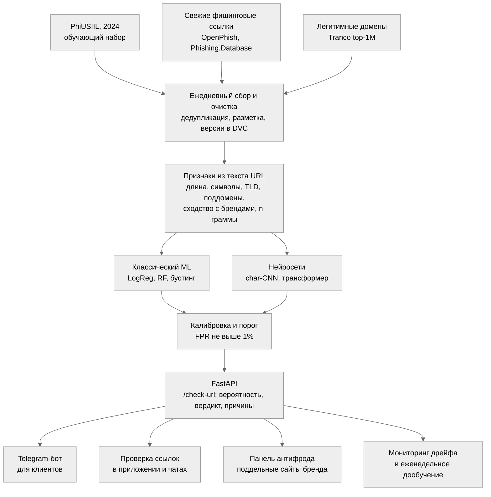
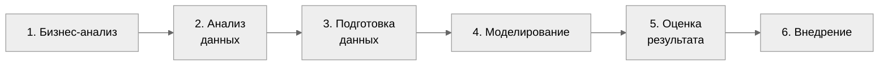

# PhishScan KZ

**Распознавание фишинговых ссылок с помощью машинного обучения**

Этап 1. Бизнес-анализ (Business Understanding)

| Автор | Методология | Этап |
|---|---|---|
| Данияр Тайшыбаев | CRISP-DM | Бизнес-анализ — 1-й из 6 этапов |

> Проект использует только открытые данные. Фишинговые страницы не открываются: модель работает только с текстом ссылки.

## Содержание

- [Кратко о проекте](#summary)
- [1. Бизнес-анализ](#business)
- [1.1 Текущая ситуация](#situation)
- [1.2 Задачи с точки зрения аналитики](#dm-goals)
- [1.3 План проекта](#plan)
- [Источники](#sources)

## Кратко о проекте

| Аспект | Описание |
|---|---|
| **Проблема** | Фишинг — одна из самых распространённых схем интернет-мошенничества в Казахстане: 18,5% случаев в 2025 году. Чёрные списки узнают о новых сайтах с опозданием, а средняя фишинговая кампания длится около 21 часа, поэтому первые жертвы теряют деньги ещё до блокировки сайта. |
| **ML-задача** | Бинарная классификация ссылки (URL): «фишинговая» или «легитимная». Модель анализирует только текст ссылки, не открывая страницу, и объясняет своё решение. |
| **Данные** | Обучение — открытый набор PhiUSIIL (UCI, 2024): 235 795 ссылок. Проверка — свежие фишинговые ссылки 2026 года из OpenPhish и Phishing.Database и легитимные домены из рейтинга Tranco. |
| **Метрики** | Главная — полнота обнаружения (Recall) при доле ложных срабатываний (FPR) не выше 1% на свежих данных. Дополнительные — PR-AUC, ROC-AUC, F1, калибровка вероятностей, время ответа. |
| **Бизнес-эффект** | Проверка ссылки до перехода, в том числе в «нулевой час», когда сайта ещё нет в чёрных списках. Итог — меньше похищенных данных и денег клиентов, ниже нагрузка на контакт-центр, быстрее блокировка поддельных сайтов бренда. |

---

## 1. Бизнес-анализ (Business Understanding)

### Проблема и контекст

Фишинг — это подделка сайтов банков, госсервисов и магазинов с целью похитить логины, пароли и данные карт. В Казахстане он входит в число ведущих схем интернет-мошенничества:

| Показатель | Значение |
|---|---|
| Интернет-мошенничество, январь–ноябрь 2025 г. | **26,3 тыс.** уголовных правонарушений: +20,3% за год [1] |
| Ущерб за 2025 г. | **12,2 млрд ₸**, из них возвращено около 5 млрд ₸ [2] |
| Ущерб за I квартал 2026 г. | **4,8 млрд ₸** [2] |
| Доля фишинга | **18,5%** случаев — третья по частоте схема [3] |
| Распространённость | О фишинге сообщили 52,2% опрошенных в 2025 г. против 24% годом ранее [3] |
| Кто пострадал | 96,7% ущерба приходится на физических лиц; в полицию обращаются лишь 20,7% пострадавших, поэтому реальные потери выше [1] |

**Скорость реакции решает всё.** По данным исследования USENIX Security 2020 [4], средняя фишинговая кампания длится около 21 часа — от появления сайта до последней жертвы. При этом не менее 7,42% посетителей фишинговой страницы вводят свои данные и затем теряют деньги. Защита эффективна, только если срабатывает в первые часы, а лучше — в момент получения ссылки.

**Почему текущих мер недостаточно:**

- **Чёрные списки запаздывают.** Новый сайт попадает в базу лишь после обнаружения и проверки, поэтому ресурсы «нулевого часа» остаются незамеченными.
- **Каналы доставки не защищены.** Фишинговые ссылки приходят в SMS и мессенджерах, где браузерные предупреждения не срабатывают до перехода.
- **Блокировка занимает время.** Банк должен обнаружить поддельный сайт и направить заявку в KZ-CERT — от нескольких часов до нескольких дней.
- **Модели из публикаций плохо переносятся на новые данные.** На исходном наборе они показывают 97–100% точности, а на данных другого периода или источника — лишь 45–76% [6, 7].

### Организационная структура

Заказчик — банк второго уровня Республики Казахстан.

| Роль | Участник | Зона ответственности |
|---|---|---|
| Спонсор | Директор по информационной безопасности (CISO) | Цели проекта, приоритеты, итоговая приёмка |
| Владелец продукта | Управление по противодействию мошенничеству | Требования к качеству, допустимый уровень ложных срабатываний |
| **Ключевые пользователи** | Аналитики антифрода и SOC Клиенты банка Контакт-центр | Проверка подозрительных ссылок и мониторинг поддельных сайтов бренда Проверка ссылки в Telegram-боте или приложении до перехода Проверка ссылок по обращениям клиентов |
| Смежные подразделения | Digital, ДИТ и MLOps, комплаенс | Интеграция в каналы банка, инфраструктура, правовые вопросы и защита персональных данных |
| Внешние партнёры | KZ-CERT, антифрод-центр Национального банка | Блокировка сайтов, обмен информацией о мошенничестве |
| Исполнитель | Данияр Тайшыбаев, Data Scientist / ML-инженер | Полный цикл CRISP-DM: данные, модели, сервис, документация |

### Бизнес-цель

> **Сократить потери клиентов и банка от фишинга:** распознавать вредоносную ссылку в момент её получения — до перехода и до появления сайта в чёрных списках, практически не блокируя легитимные ресурсы.

| Показатель | Как измеряется | Цель |
|---|---|---|
| Полнота обнаружения | Доля фишинговых ссылок, распознанных сервисом (Recall), на свежих данных | ≥ 90% |
| Ложные срабатывания | Доля легитимных ссылок, ошибочно помеченных как фишинговые (FPR) | ≤ 1% |
| Защита «нулевого часа» | Доля ссылок, распознанных раньше, чем они попали во второй независимый чёрный список | Выше, чем у чёрного списка |
| Скорость ответа | Время ответа API, 95-й перцентиль | ≤ 100 мс |
| Объяснимость | Доля вердиктов с понятной причиной, например «домен похож на kaspi.kz» | 100% |

**Оценка эффекта (порядок величины):**

| Параметр | Значение | Основание |
|---|---|---|
| Ущерб от интернет-мошенничества в РК за 2025 г. | 12,2 млрд ₸ | Генпрокуратура [2] |
| Доля фишинга | 18,5% | [3] |
| Оценка ущерба от фишинга | ≈ 2,3 млрд ₸ в год | 12,2 × 0,185 |
| Доля рынка банка-заказчика | 10% | Допущение |
| Доля фишинговых переходов клиентов, которые видит сервис | 50% | Допущение |
| Полнота обнаружения | 90% | Целевое значение |
| **Предотвращённый ущерб** | **≈ 0,1 млрд ₸ в год** | 2,3 × 0,1 × 0,5 × 0,9 |

Оценка консервативна: она не учитывает незаявленные случаи, затраты на обработку обращений и репутационный ущерб. Допущения будут уточнены на этапе оценки результата.

### Существующие решения

| Решение | Принцип работы | Ограничения |
|---|---|---|
| Чёрные списки (Google Safe Browsing, OpenPhish, Phishing.Database) | Сверка ссылки с базой известных фишинговых адресов | Не распознают новые сайты. Safe Browsing API предназначен только для некоммерческого использования, для бизнеса Google предлагает Web Risk API [9] |
| Защита в браузере и почте | Предупреждение при открытии сайта из чёрного списка | Опирается на те же списки; не защищает в SMS и мессенджерах |
| Блокировка через KZ-CERT | Банк находит поддельный сайт и направляет заявку на блокировку | От нескольких часов до нескольких дней; первые жертвы уже пострадали |
| Коммерческие сервисы защиты бренда | Поиск и блокировка поддельных доменов | Высокая стоимость, закрытые алгоритмы, нет интеграции в каналы общения с клиентом |
| Повышение финансовой грамотности | Обучение клиентов признакам мошенничества | Необходимо, но более трети опрошенных пока не распознают мошенничество [1] |

**Преимущества предлагаемого решения:**

- **Мгновенная и безопасная проверка** — модель анализирует только текст ссылки, страница не открывается.
- **Защита «нулевого часа»** — качество проверяется на свежих данных 2026 года, а не только на исходном наборе.
- **Понятный вердикт** — каждое решение сопровождается причиной, понятной клиенту.
- **Актуальность модели** — мониторинг дрейфа данных и регулярное дообучение на свежих фидах.

### Предлагаемое решение

**Сценарии использования:**

| Пользователь | Сценарий |
|---|---|
| Клиент | Пересылает подозрительную ссылку из SMS в Telegram-бот банка и за секунду получает вердикт с причиной: «домен имитирует kaspi.kz; в адресе есть слово login» |
| Чат поддержки, приложение | Автоматически проверяют ссылки в сообщениях и предупреждают клиента до перехода |
| Аналитик антифрода | Видит ленту новых доменов, похожих на бренд банка, и направляет их на блокировку в KZ-CERT |
| Оператор контакт-центра | Проверяет ссылку, которую диктует клиент во время звонка |

---

## 1.1 Текущая ситуация (Assessing current solution)

### Ресурсы

| Ресурс | Что есть | Дополнительные затраты |
|---|---|---|
| Вычисления | Рабочая станция (CPU): достаточно для признаков URL, градиентного бустинга и символьной свёрточной сети | Не требуются |
| GPU | Облачные Kaggle Notebooks и Google Colab — бесплатно, сессии до 12 часов [14]; нужны только для экспериментов с трансформером | Не требуются |
| Развёртывание | Docker Compose, FastAPI, PostgreSQL | Не требуются; VPS — для пилотной эксплуатации |
| Канал для клиентов | Telegram Bot API | Бесплатно |

### Данные

| Источник | Назначение | Объём и обновление | Доступ и лицензия |
|---|---|---|---|
| **PhiUSIIL Phishing URL Dataset** [11] | Обучающий набор: строка URL, домен, TLD и более 50 признаков URL и HTML. Метка: 1 — легитимная, 0 — фишинговая | 235 795 ссылок: 134 850 легитимных и 100 945 фишинговых; 2024 г. | Свободный доступ, CC BY 4.0 · [скачать ZIP](https://archive.ics.uci.edu/static/public/967/phiusiil+phishing+url+dataset.zip) |
| **OpenPhish Community Feed** [10] | Свежие фишинговые ссылки для проверки качества во времени | Обновляется каждые 12 часов | Бесплатно · [feed.txt](https://github.com/openphish/public_feed) |
| **Phishing.Database** [12] | Второй независимый список для теста «нулевого часа» | ≈ 59 тыс. активных ссылок, 784 тыс. за всё время; регулярное обновление | MIT · [репозиторий](https://github.com/Phishing-Database/Phishing.Database) |
| **Tranco top-1M** [13] | Легитимные домены, в том числе казахстанские (.kz) | 1 млн доменов, обновляется ежедневно | Бесплатно · [скачать CSV](https://tranco-list.eu/top-1m.csv.zip) |

**Хранение.** Ежедневные снимки фидов и исходные наборы сохраняются в `data/raw` и конвертируются в Parquet; версии данных ведутся в DVC, журнал запросов сервиса — в PostgreSQL. Закупка внешних данных не требуется.

**Безопасность.** Фишинговые страницы не открываются и не скачиваются — используется только текст ссылок. Признаки HTML берутся исключительно из PhiUSIIL, где они уже рассчитаны.

### Возможные риски и меры по их снижению

| № | Риск | Вероятность | Влияние | Меры |
|:-:|---|:-:|:-:|---|
| 1 | **Утечка в признаках** — URLSimilarityIndex практически выдаёт ответ: CatBoost достигает 100% точности [8] | Высокая | Высокое | Исключить такие признаки; основная модель — только по тексту URL; проверка силы каждого признака по отдельности |
| 2 | **Дрейф данных** — на данных другого периода качество моделей падает до 45–76% [6, 7] | Высокая | Высокое | Основная оценка — на свежих данных 2026 года; еженедельный мониторинг и дообучение |
| 3 | **Смещение выборки** — легитимные примеры чаще короткие, фишинговые длинные, и модель учит «форму» ссылки | Высокая | Среднее | Добавить легитимные ссылки с путями; разбиение на обучение и тест по домену; анализ ошибок |
| 4 | **Шум в разметке фидов** — сайт уже удалён или попал в список ошибочно | Средняя | Среднее | Дедупликация, сверка нескольких источников, исключение спорных записей |
| 5 | **Ложные блокировки** вызывают недовольство клиентов | Средняя | Высокое | Порог по FPR ≤ 1%; предупреждение с причиной вместо блокировки; кнопка «Это ошибка» |
| 6 | **Адаптация злоумышленников** к модели | Средняя | Среднее | Ансамбль моделей, сверка с чёрными списками, регулярное дообучение |
| 7 | **Сокращённые ссылки** (bit.ly и аналоги) скрывают настоящий адрес | Средняя | Среднее | В MVP — статус «требуется проверка»; далее — раскрытие адреса в изолированной среде |
| 8 | **Слабые закономерности на свежих данных** — результат не заинтересует заказчика | Низкая | Высокое | Сравнение с чёрным списком в «нулевой час»: даже частичный выигрыш ценен; прозрачный отчёт о границах применимости |

---

## 1.2 Задачи с точки зрения аналитики (Data Mining goals)

### Постановка задачи

- **Тип задачи:** бинарная классификация. Вход — строка URL, выход — вероятность того, что ссылка фишинговая.
- **Целевая переменная:** метка PhiUSIIL инвертируется — 1 означает фишинговую ссылку, 0 — легитимную.
- **Основной трек (для сервиса):** признаки только из текста URL. Работает мгновенно и безопасно.
- **Исследовательский трек:** URL и признаки HTML из PhiUSIIL — показывает, какой прирост качества даёт содержимое страницы.

**Схема валидации:**

1. **Кросс-валидация на PhiUSIIL** с разбиением по домену: один домен не попадает одновременно в обучение и тест.
2. **Тест на свежих данных:** фишинговые ссылки из фидов за ноябрь–декабрь 2026 года и легитимные домены из Tranco.
3. **Тест «нулевого часа»:** ссылки, появившиеся в одном фиде, но ещё не попавшие во второй, независимый.

### Модели

| Группа | Модели | Назначение |
|---|---|---|
| Текущее решение | Сверка с чёрным списком, простые правила: IP вместо домена, символ «@», длина | Базовый уровень, который нужно превзойти |
| Классический ML | Логистическая регрессия на символьных n-граммах (TF-IDF), Random Forest, LightGBM, XGBoost, CatBoost на ручных признаках | Быстрые и интерпретируемые модели |
| Глубокое обучение | Символьная свёрточная сеть (char-CNN), char-BiLSTM, дообучение компактного трансформера (опционально) | Учёт структуры строки без ручных признаков |
| Ансамбль и калибровка | Усреднение вероятностей, калибровка Платта или изотоническая, выбор порога по FPR | Устойчивый вердикт и корректная вероятность |
| Объяснимость | SHAP и правила перевода признаков в понятные причины | Ответ клиенту на вопрос «почему» |

<b>Признаки, извлекаемые из URL</b>

- **Структура:** длина ссылки и домена; количество точек, дефисов, цифр и спецсимволов; число поддоменов; IP-адрес вместо домена; HTTPS.
- **Статистика строки:** энтропия, доля цифр и букв.
- **Домен:** доменная зона (TLD), punycode, похожие символы из других алфавитов.
- **Ключевые слова:** login, verify, secure, account, update и подобные.
- **Сходство с брендами:** расстояние Левенштейна до kaspi, halyk, homebank, egov и других.
- **Сервисы сокращения ссылок:** bit.ly и аналоги.

### Метрики оценки

Accuracy для этой задачи недостаточно: в реальном потоке фишинговых ссылок значительно меньше, чем обычных, а ложная блокировка обходится дорого. Поэтому качество оценивается при фиксированной доле ложных срабатываний.

| Метрика | Что показывает |
|---|---|
| **Recall при FPR ≤ 1%** — основная | Какую долю фишинга мы ловим, почти не затрагивая легитимные сайты |
| PR-AUC | Качество в условиях дисбаланса классов |
| ROC-AUC | Общую разделяющую способность модели |
| Precision, F1 | Баланс точности и полноты на выбранном пороге |
| Brier score, ECE | Насколько предсказанные вероятности соответствуют реальным (калибровка) |
| Время ответа (p95), размер модели | Пригодность для работы в реальном времени |
| PSI ключевых признаков, Recall по неделям | Дрейф данных при мониторинге |

### Критерии успеха

| Критерий | Минимум (MVP) | Цель |
|---|:-:|:-:|
| ROC-AUC на PhiUSIIL без признаков-утечек, разбиение по домену | ≥ 0,97 | ≥ 0,99 |
| Recall при FPR ≤ 1% на свежих данных 2026 года | ≥ 80% | ≥ 90% |
| Recall при FPR ≤ 1% в «нулевой час» | ≥ 70% | ≥ 85% |
| Выигрыш над чёрным списком в «нулевой час» | Есть | ≥ 20 п.п. |
| Калибровка (ECE) | ≤ 0,05 | ≤ 0,02 |
| Время ответа API на CPU (p95) | ≤ 100 мс | ≤ 30 мс |

Пороги для свежих данных ниже, чем для PhiUSIIL: по данным исследований, на данных другого периода или источника модели теряют 20–40 п.п. качества [6, 7].

---

## 1.3 План проекта (Project Plan)

Проект разделён на шесть этапов по методологии CRISP-DM. Сбор свежих фидов запускается на этапе анализа данных и идёт параллельно с остальными этапами: так к этапу оценки накапливаются свежие ссылки для проверки модели.

| Этап CRISP-DM | Основные работы | Результат |
|---|---|---|
| 1. Бизнес-анализ | Цели, пользователи, метрики, риски, план | Настоящий документ |
| 2. Анализ данных | EDA PhiUSIIL, поиск утечек в признаках; запуск ежедневного сбора OpenPhish, Phishing.Database и Tranco | Отчёт об анализе и качестве данных |
| 3. Подготовка данных | Инверсия метки, дедупликация, разбиение по домену, признаки URL и сходства с брендами, свежий тестовый набор, версии в DVC | Датасет v1 и воспроизводимый пайплайн |
| 4. Моделирование | Правила и чёрный список → LogReg → Random Forest и бустинг → char-CNN → трансформер (опционально) → ансамбль и калибровка; трекинг в MLflow | Сравнительная таблица моделей |
| 5. Оценка результата | Тест на свежих данных и в «нулевой час», сравнение с чёрным списком, анализ ошибок, перевод в бизнес-показатели, выбор порога | Отчёт об оценке модели |
| 6. Внедрение | FastAPI `/check-url`, Telegram-бот, Docker Compose, мониторинг дрейфа, еженедельное дообучение | Работающий сервис и документация |

---

## Источники

1. Informburo.kz. [Рекордное количество: сколько случаев мошенничества в сети зарегистрировали в Казахстане в 2025 году](https://informburo.kz/novosti/rekordnoe-kolicestvo-skolko-slucaev-mosennicestva-v-seti-zaregistrirovali-v-kazaxstane-v-2025-godu) (31.12.2025, по данным Finprom.kz).
2. Bes.media. [Жертвам интернет-мошенничества вернули 5 млрд тенге за 2025 год](https://bes.media/news/zhertvam-internet-moshennichestva-vernuli-5-mlrd-tenge-za-2025-god-29b6f5/) (08.04.2026, данные Генпрокуратуры).
3. Inbusiness.kz. [Звонки «из банка»: какие схемы интернет-мошенничества доминировали в 2025 году](https://inbusiness.kz/ru/last/zvonki-iz-banka-kakie-shemy-internet-moshennichestva-dominirovali-v-2025-godu) (31.12.2025).
4. Oest A. et al. [Sunrise to Sunset: Analyzing the End-to-end Life Cycle and Effectiveness of Phishing Attacks at Scale](https://www.usenix.org/conference/usenixsecurity20/presentation/oest-sunrise). USENIX Security Symposium, 2020.
5. Prasad A., Chandra S. PhiUSIIL: A diverse security profile empowered phishing URL detection framework. *Computers & Security*, 2024. DOI: 10.1016/j.cose.2023.103545.
6. Fernando W., Komninos N. [Evaluating and Combating the Impact of Concept Drift on the Performance of Machine Learning-Based Phishing Detection Systems](https://arxiv.org/abs/2606.11471). arXiv, 2026.
7. [Can Features for Phishing URL Detection Be Trusted Across Diverse Datasets? A Case Study with Explainable AI](https://arxiv.org/abs/2411.09813). arXiv, 2024.
8. [Enhancing Phishing Detection through Feature Importance Analysis and Explainable AI: A Comparative Study of CatBoost, XGBoost, and EBM Models](https://arxiv.org/abs/2411.06860). arXiv, 2024.
9. Google. [Safe Browsing API — Permitted Use](https://developers.google.com/safe-browsing/reference/Appropriate.Usage).
10. [OpenPhish Community Phishing Feed](https://github.com/openphish/public_feed).
11. UCI Machine Learning Repository. [PhiUSIIL Phishing URL Dataset](https://archive.ics.uci.edu/dataset/967/phiusiil+phishing+url+dataset).
12. [Phishing.Database](https://github.com/Phishing-Database/Phishing.Database).
13. [Tranco: A Research-Oriented Top Sites Ranking](https://tranco-list.eu/).
14. [Free Cloud GPUs in 2026](https://gpuperhour.com/blog/free-cloud-gpus-and-credits) — лимиты Kaggle и Colab (21.09.2026).
